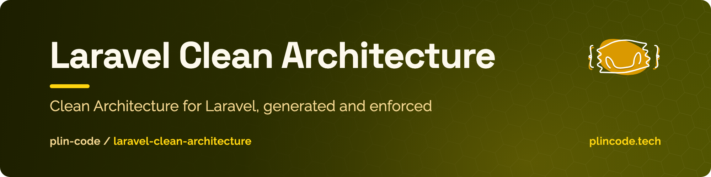

# Laravel Clean Architecture

A Laravel package to easily implement Clean Architecture in your projects.

<p align="center">
    <a href="https://packagist.org/packages/plin-code/laravel-clean-architecture"></a>
    <a href="https://packagist.org/packages/plin-code/laravel-clean-architecture"></a>
    <a href="https://packagist.org/packages/plin-code/laravel-clean-architecture"></a>
    <a href="https://github.com/plin-code/laravel-clean-architecture/actions"></a>
    <a href="https://packagist.org/packages/plin-code/laravel-clean-architecture"></a>
</p>

## ✨ Features

- 🎯 **Domain-Driven Design** - Organize your code with DDD principles
- ⚡ **Quick Setup** - Get started with Clean Architecture in minutes
- 🧩 **Auto-Generation** - Generate complete domains with one command
- 🏛️ **Layer Separation** - Clear separation between Domain, Application, and Infrastructure
- 🔧 **Customizable** - Flexible configuration to fit your project needs
- 🧪 **Test-Ready** - Pre-built test templates for immediate testing
- 📚 **Well-Documented** - Comprehensive documentation and examples
- 🎨 **Modern PHP** - Built for PHP 8.3+ with latest Laravel features

## 📋 Requirements

- 🐘 PHP 8.3+
- ⚡ Laravel 12.x / 13.x

## 📦 Installation

```bash
composer require plin-code/laravel-clean-architecture
```

## ⚙️ Configuration

Publish the configuration files and stubs:

```bash
php artisan vendor:publish --provider="PlinCode\LaravelCleanArchitecture\CleanArchitectureServiceProvider"
```

## 🎯 Usage

### 🏗️ Installing Clean Architecture structure

```bash
php artisan clean-arch:install
```

This command will create:
- 📁 Folder structure for Domain, Application and Infrastructure layers
- 🧩 Base classes (BaseModel, BaseAction, BaseService, etc.)
- ⚙️ Configuration file
- 📖 Documentation

#### 👤 Moving the `User` model into the Domain

```bash
php artisan clean-arch:install --user-in-domain
composer dump-autoload
```

Laravel keeps `User` in `app/Models`, outside the directories the generated phparkitect rules check. This option moves it into the Domain layer of a **fresh** app, following `directories.domain` and `generation.model_directory`, so with the defaults you get `app/Domain/Users/Models/User.php` declaring `App\Domain\Users\Models\User`.

It also:
- keeps `User` an `Authenticatable`, it does not extend `BaseModel` (whose `SoftDeletes` needs a `deleted_at` column the `users` table does not have)
- adds `newFactory()` to the model and a `$model` property to `database/factories/UserFactory.php`, since the factory resolver derives both names from the old namespace
- rewrites `App\Models\User` in the PHP files of `app/`, `config/`, `database/`, `routes/` and `tests/`, in code and inside strings, and prints every file it changed
- registers `Relation::morphMap(['user' => User::class])` in `AppServiceProvider::boot()`, so polymorphic `*_type` columns store `user` instead of a namespace
- renames the `App.Models.User.{id}` broadcast channel in `routes/channels.php`
- removes `app/Models` and `app/Http` once they hold nothing but the default empty base controller

It does not touch `vendor/`, `node_modules/` or `storage/`, and it does not migrate data. If `resources/js` or `resources/ts` listens on `App.Models.User.{id}`, the command warns and names the files. Those Echo listeners have to be renamed by hand.

The command refuses to change anything when `app/Models` holds other models (pass `--force` to move `User` anyway) or when both the source and the destination exist. For an app that is already running in production, read [Moving `User` into the Domain in an existing app](#-moving-user-into-the-domain-in-an-existing-app) first.

Laravel's own generators (`make:model`, `make:controller`, `make:request`) recreate `app/Models` and `app/Http`. After this option, use the `clean-arch:make-*` commands instead.

#### 🚚 Migrating an existing app into the layers

```bash
php artisan clean-arch:install --migrate-app
composer dump-autoload
```

Without options, `clean-arch:install` creates the layers next to the folders Laravel ships with and leaves those folders alone, so an app ends up with both `app/Http/Controllers` and `app/Infrastructure/Http/Controllers`. `--migrate-app` moves the code of those folders into the layers, rewrites the namespaces and every reference, and prints each file it moved, changed or removed. It works on a fresh app, on an app created from a starter kit (the React, Vue and Livewire kits ship folders such as `app/Http/Controllers/Settings`, `app/Http/Middleware`, `app/Http/Requests/Settings`, `app/Actions/Fortify` and `app/Concerns`), and on an app where some of these folders do not exist, which are skipped.

| From | To |
|---|---|
| `app/Http/Controllers` | `Infrastructure/Http/Controllers` |
| `app/Http/Middleware` | `Infrastructure/Http/Middleware` |
| `app/Http/Requests` | `Infrastructure/Http/Requests` |
| `app/Http/Resources` | `Infrastructure/Http/Resources` |
| `app/Console/Commands` | `Infrastructure/Console/Commands` |
| `app/Mail`, `app/Notifications`, `app/Observers`, `app/Exports` | `Infrastructure/Mail`, `Infrastructure/Notifications`, `Infrastructure/Observers`, `Infrastructure/Exports` |
| `app/Actions`, `app/Services`, `app/Jobs`, `app/Listeners`, `app/Concerns` | `Application/Actions`, `Application/Services`, `Application/Jobs`, `Application/Listeners`, `Application/Concerns` |
| `app/Models/User.php` | `Domain/Users/Models/User.php`, as with `--user-in-domain`, when `User` is the only model |

The destinations follow `directories`, so with `app/Core/Infrastructure` the controllers land in `app/Core/Infrastructure/Http/Controllers`. Subfolders are kept: `app/Http/Controllers/Settings/ProfileController.php` becomes `app/Infrastructure/Http/Controllers/Settings/ProfileController.php` declaring `App\Infrastructure\Http\Controllers\Settings`.

It also:
- deletes the empty abstract `Controller` Laravel ships, so its subclasses extend the base controller `clean-arch:install` writes and the app keeps a single base controller
- rewrites the old namespaces in the PHP files of `app/`, `bootstrap/` (without `bootstrap/cache`), `config/`, `database/`, `routes/` and `tests/`, in code, inside strings and in fully qualified names
- adds `->withCommands([...])` for moved console commands and `->withEvents(discover: [...])` for moved listeners to `bootstrap/app.php`, since Laravel only discovers them in `app/Console/Commands` and `app/Listeners`. When `bootstrap/app.php` has no `return Application::configure(...)` line, or already calls `withEvents()` (a second call would replace its discovery paths), it prints the exact lines to add instead
- rewrites [Wayfinder](https://github.com/laravel/wayfinder) imports in `resources/js` and `resources/ts`, `@/actions/App/Http/Controllers/...` becoming `@/actions/App/Infrastructure/Http/Controllers/...`. The generated `actions`, `routes` and `wayfinder` folders are left to Wayfinder: run `php artisan wayfinder:generate --with-form` (or the next Vite build) to regenerate them
- removes the folders it emptied, then lists every PHP file still outside the layers

What stays where it is, and why:
- `app/Providers`: `bootstrap/providers.php` registers the providers there, and `validation.outside_layers_allowed` allows it by default.
- `app/Models` when it holds other models besides `User`: models of one namespace name each other without imports, factories and policies are found from the model namespace, and polymorphic columns store the class name. Moving them is a decision per model, so all of them stay, `User` included, and the command says so. Move them by hand (the layout `clean-arch:make-domain` generates is a reference), or move `User` alone with `--user-in-domain --force`.
- `app/Policies`: policy auto discovery looks in `App\Policies`. Keep it, and add `'Policies'` to `validation.outside_layers_allowed`.
- Every other folder, such as `app/Events`, `app/Enums`, `app/Rules`, `app/Livewire`, `app/View` or `app/Filament`: Livewire, Blade components and Filament find their classes by namespace or by path, so these folders are listed and left for you to decide.

Before moving anything the command checks every destination. When one already exists, including the base classes `clean-arch:install` writes (`Http/Controllers/Controller.php`, `Http/Requests/BaseRequest.php`, `Actions/BaseAction.php`, `Services/BaseService.php`), it prints every conflict and exits 1 without changing a file. A base controller with code of its own is such a conflict. `--force` replaces the destination with the file of the app, and, as always with `--force`, also overwrites the files `clean-arch:install` generates. `vendor/`, `node_modules/` and `storage/` are never touched.

What it does not do:
- It does not rewrite paths written as strings, such as `app_path('Http/Controllers')` or `__DIR__.'/../app/Console/Commands'`, nor files that are not PHP outside the Wayfinder imports (Blade views, `phpunit.xml`, `phpstan.neon`).
- It does not sort the `use` statements it rewrites. Run your formatter afterwards.
- It does not migrate data. A job or a listener already serialized in the queue names its old class, so drain the queue before deploying, as for [moving `User`](#-moving-user-into-the-domain-in-an-existing-app).
- It does not run `composer dump-autoload`, Wayfinder or your tests. Run them, then turn on [`no_classes_outside_layers`](#-no-classes-outside-the-layers) to keep the app inside the layers.

### 🆕 Creating a new domain

```bash
php artisan clean-arch:make-domain User
```

This command will generate:
- 🏛️ Domain model with events
- 📊 Status enums
- 🔔 Domain events (Created, Updated, Deleted)
- ⚡ Actions (Create, Update, Delete, GetById, List)
- 🌐 API Controller
- 📝 Form Requests (Create, Update)
- 📤 API Resource
- 🗃️ Database migration
- 🏭 Model factory in `database/factories`, which the model names in `newFactory()`
- 🧪 Feature tests

After generating the core files, `make-domain` prompts interactively for optional components. You can choose to also generate an Observer, Listener, Job, Mail, Notification, and Export for the domain. Each prompt can be answered independently, so you only generate what your domain needs.

`make-domain` does not touch your routes. When it finishes it prints the `Route::apiResource()` line for the generated controller, which the generated feature test calls under `/api`. Add it to `routes/api.php`. A fresh Laravel app has no such file: `php artisan install:api` creates it and registers it in `bootstrap/app.php`, and it also installs Sanctum.

### ✅ Architecture validation

Architectural rules are enforced by [phparkitect](https://github.com/phparkitect/arkitect). The package does not depend on it and does not run it: it generates a configuration file from `config/clean-architecture.php`, and your project runs the tool.

```bash
composer require --dev phparkitect/phparkitect
php artisan clean-arch:make-arch-rules
vendor/bin/phparkitect check
```

`clean-arch:make-arch-rules` writes `phparkitect.php` in the project root, built from `directories`, `default_namespace` and `validation.rules`. It refuses to overwrite an existing file, so pass `--force` when you want to regenerate one. The generated file is ordinary PHP: once you need rules the package does not generate, edit it by hand and stop regenerating it.

`phparkitect check` exits 1 when it finds violations, which is what you want in CI. Rules can be disabled one by one, see [Validation rules](#-validation-rules).

Delegating brings something the previous hand written analyser could not do: inheritance chains are followed. A console command extending a project specific base class that itself extends `Illuminate\Console\Command` is now reported, and so is a job extending an abstract base job that implements `ShouldQueue`.

#### 🛡️ The autoload guard

The generated file opens with a check that looks out of place until it saves you:

```php
if (! class_exists(\Illuminate\Console\Command::class)
    || ! class_exists(\App\Domain\Shared\BaseModel::class)) {
    throw new RuntimeException(
        'clean-architecture: autoloading does not resolve the application classes, '
        . 'so the reflection based rules would pass silently. Run composer dump-autoload.'
    );
}
```

Two of the rules are reflection based. When autoloading does not resolve the classes being scanned, `is_a()` reads an unloadable class as "not a subclass", so those rules report nothing and phparkitect exits 0. In CI that is indistinguishable from a clean run. The guard turns that case into a failure with a message, and it costs nothing because it runs before the scan.

The class it names is the one `clean-arch:install` generates for your domain layer. If you rename or remove it, the guard fires even with a sound autoloader. That is a false alarm, and it is the right way round to be wrong: a false alarm is loud and the message says what to look at, a silent pass is neither. Point the check at another class of yours and keep it.

#### 📋 Adopting it on an existing codebase

A codebase that has never been checked usually starts with a long list of violations. Record them once and fail only on new ones:

```bash
vendor/bin/phparkitect generate-baseline
vendor/bin/phparkitect check
```

`generate-baseline` writes `phparkitect-baseline.json` with the violations found today, and `check` picks that file up automatically and exits 0. Regenerate it as you fix things, or pass `--skip-baseline` to see the full list again. Fixing the recorded violations does not require regenerating: the baseline is a list of what to ignore, not a target.

### 🛠️ Available commands

- `clean-arch:install {--force} {--user-in-domain} {--migrate-app}`: 🏗️ Install Clean Architecture structure, optionally moving the `User` model into the Domain layer, or the code of the Laravel folders into the layers
- `clean-arch:make-domain {name} {--force} {--no-base}`: 🆕 Create a complete new domain
- `clean-arch:make-action {name} {domain} {--force} {--no-base}`: ⚡ Create a new action
- `clean-arch:make-service {name} {--force} {--no-base}`: 🔧 Create an empty service, for logic shared by several actions
- `clean-arch:make-controller {name} {--api} {--web} {--force}`: 🌐 Create a new controller
- `clean-arch:make-observer {name} {domain} {--force}`: 👁️ Create a new observer
- `clean-arch:make-listener {name} {--force}`: 👂 Create a new listener
- `clean-arch:make-job {name} {--force}`: ⏳ Create a new job
- `clean-arch:make-mail {name} {--force}`: 📧 Create a new mailable
- `clean-arch:make-notification {name} {--force}`: 🔔 Create a new notification
- `clean-arch:make-export {name} {--force}`: 📤 Create a new export
- `clean-arch:make-arch-rules {--force}`: 🛡️ Generate a phparkitect config from the configured rules
- `clean-arch:generate-package {name} {vendor} {--force}`: 📦 Generate a new package

### 📂 Project structure after `clean-arch:install`

```
app/
├── Domain/                          # Business logic (Eloquent models, enums, events)
├── Application/                     # Use cases and orchestration
│   ├── Actions/
│   ├── Services/
│   ├── Jobs/
│   └── Listeners/
└── Infrastructure/                  # Framework adapters
    ├── Http/
    │   ├── Controllers/
    │   │   ├── Api/
    │   │   └── Web/
    │   ├── Middleware/
    │   ├── Requests/
    │   └── Resources/
    ├── Mail/
    ├── Notifications/
    ├── Observers/
    ├── Exports/
    ├── Validation/
    ├── Console/Commands/
    └── Exceptions/
```

Laravel only auto-discovers commands in `app/Console/Commands`, so register the commands of the Infrastructure layer in `bootstrap/app.php` (adjust the path if you changed `directories.infrastructure`):

```php
->withCommands([
    __DIR__.'/../app/Infrastructure/Console/Commands',
])
```

### 📂 Generated structure after `clean-arch:make-domain User`

The model sits in a `Models` subfolder by default. Set `generation.model_directory` to change or drop it, see [Model directory](#-model-directory).

```
app/
├── Domain/
│   └── Users/
│       ├── Models/
│       │   └── User.php
│       ├── Enums/
│       │   └── UserStatus.php
│       └── Events/
│           ├── UserCreated.php
│           ├── UserUpdated.php
│           └── UserDeleted.php
├── Application/
│   ├── Actions/
│   │   └── Users/
│   │       ├── CreateUserAction.php
│   │       ├── UpdateUserAction.php
│   │       ├── DeleteUserAction.php
│   │       ├── GetByIdUserAction.php
│   │       └── ListUsersAction.php
└── Infrastructure/
    └── Http/
        ├── Controllers/
        │   └── Api/
        │       └── UsersController.php
        ├── Requests/
        │   ├── CreateUserRequest.php
        │   └── UpdateUserRequest.php
        └── Resources/
            └── UserResource.php
```

## 🏛️ Clean Architecture Principles

This package implements Clean Architecture principles:

1. **🎯 Domain Layer**: Contains business logic and entities
2. **⚡ Application Layer**: Contains use cases and application logic
3. **🏗️ Infrastructure Layer**: Contains implementation details (controllers, database, etc.)

### 🔗 Dependencies

- **🎯 Domain Layer**: Does not depend on the Application or Infrastructure layers
- **⚡ Application Layer**: Depends only on Domain Layer
- **🏗️ Infrastructure Layer**: Depends on Application and Domain Layers

### 🔌 Crossing a layer with a contract

When an inner layer needs something an outer layer provides, it declares an interface and the outer layer implements it. The binding lives in a service provider, so the inner layer only ever sees the interface.

- **External service**: the interface sits in `App\Application\Contracts` (for example `PaymentGateway`), the adapter in `App\Infrastructure` (`StripePaymentGateway`). Switching provider means a new adapter and a new binding.
- **Domain asking the outside**: the domain needs an answer it does not own, such as a feature flag. The interface sits in the domain (`App\Domain\Orders\Contracts\DiscountsGate`), the implementation in `App\Application`.
- **Shared capability**: several models implement the same interface (`HasSlug`), so one service handles all of them.

```php
// AppServiceProvider::register()
$this->app->bind(PaymentGateway::class, StripePaymentGateway::class);
```

A class with a single implementation, used only inside its own layer, needs no contract.

### 🗄️ The Domain layer depends on Eloquent

This is a deliberate trade-off, and it is worth stating explicitly. `clean-arch:install` generates `App\Domain\Shared\BaseModel`, which extends `Illuminate\Database\Eloquent\Model`, and every model produced by `clean-arch:make-domain` extends it. The Domain layer is therefore free of Application and Infrastructure imports (that is what the generated rules enforce), but it is not free of the framework.

If you need a persistence agnostic domain, this package is not the right starting point.

### 🔒 Transactions

Generated actions do not open a transaction. When a use case has an invariant that only holds if several writes, or a read and a write, happen atomically, the action opens it itself (with `lockForUpdate()` when it reads before writing). Callers may still wrap it in a larger transaction, since Laravel nests them with savepoints. Mail, events and jobs go in `DB::afterCommit()`, so nothing leaves the system before the data is committed.

## 💡 Examples

### 🛍️ Creating a Product domain

```bash
php artisan clean-arch:make-domain Product
```

### 🎮 Using in controller

```php
class ProductsController extends Controller
{
    public function __construct(
        private CreateProductAction $createProductAction
    ) {}

    public function store(CreateProductRequest $request): JsonResponse
    {
        $product = $this->createProductAction->execute($request->validated());
        
        return response()->json([
            'data' => new ProductResource($product),
            'message' => 'Product created successfully'
        ], 201);
    }
}
```

An action never receives the HTTP request. The controller passes `$request->validated()`, an array, and models already resolved. A readonly DTO is fine when several callers must normalise the same input.

### 📍 Classes without a generator

DTOs, policies and Filament panels have no `clean-arch` command. Create them straight in their layer, not in a Laravel default folder to move them afterwards.

| Class | Where | How |
|---|---|---|
| Readonly DTO | `app/Application/DTOs` | `php artisan make:class Application/DTOs/RegistrationData` |
| Policy of a domain model | a `Policies` folder next to the model, `app/Domain/Articles/Policies` | `php artisan make:class Domain/Articles/Policies/ArticlePolicy` |
| Filament resources, pages, widgets | `app/Infrastructure/Filament` | `make:filament-resource`, after pointing the panel at that folder |

Laravel's policy discovery walks up from the model namespace, so `App\Domain\Articles\Policies\ArticlePolicy` is found for `App\Domain\Articles\Models\Article` (and for `App\Domain\Articles\Article`) without registering anything. `make:policy` writes to `app/Policies`, outside the layers. A policy only imports domain classes, so it breaks no rule.

A Filament panel is an input adapter like a controller. Point the panel provider at the infrastructure layer before generating anything:

```php
->discoverResources(in: app_path('Infrastructure/Filament/Resources'), for: 'App\\Infrastructure\\Filament\\Resources')
->discoverPages(in: app_path('Infrastructure/Filament/Pages'), for: 'App\\Infrastructure\\Filament\\Pages')
->discoverWidgets(in: app_path('Infrastructure/Filament/Widgets'), for: 'App\\Infrastructure\\Filament\\Widgets')
```

`make:filament-resource` then writes there by itself. Its `--resource-namespace` option is ignored for a namespace the panel does not discover: the command falls back to `app/Filament` and overwrites what is there. The panel provider itself stays in `app/Providers`.

## ⚙️ Configuration

`clean-arch:install` writes `config/clean-architecture.php`. It skips any file that already exists, so editing the config or a generated base class is safe to keep across reinstalls. Pass `--force` to overwrite them instead. You can also publish the config on its own:

```bash
php artisan vendor:publish --tag=clean-architecture-config
```

Every `make-*` command and `clean-arch:generate-package` follow the same rule for the files they write. A command that only ever writes one file (`make-action`, `make-service`, `make-controller`, `make-observer`, `make-listener`, `make-job`, `make-mail`, `make-notification`, `make-export`) refuses to overwrite an existing target, prints an error naming the path, and exits with a failure code, so a script or an AI agent rerunning a generator notices instead of losing hand written code. A command that writes several files (`make-domain`, `clean-arch:generate-package`) skips the ones that already exist and still writes the rest, printing a `Skipped:` line for each. Pass `--force` on any of them to overwrite instead.

### 📁 Directories

`directories` is read by `clean-arch:install` and the `make-*` commands, which write the generated classes at those paths, and by `clean-arch:make-arch-rules`, which turns them into the namespaces and the class sets of the generated config. The layer namespaces are derived from the same values, so `app/Core/Domain` with a `default_namespace` of `Acme` becomes `Acme\Core\Domain`.

```php
'default_namespace' => 'App',

'directories' => [
    'domain' => 'app/Domain',
    'application' => 'app/Application',
    'infrastructure' => 'app/Infrastructure',
],
```

When the config file is not published, the defaults above are used.

The package does not edit your autoloader. Laravel maps `App\` to `app/` in `composer.json`, which covers every directory under `app/` as long as `default_namespace` stays `App`. Any other combination needs a PSR-4 entry of its own, otherwise the classes are generated but cannot be loaded:

| Configuration | Generated namespace | Entry to add under `autoload.psr-4` |
|---|---|---|
| `app/Core/Domain` with `App` | `App\Core\Domain` | none |
| `app/Domain` with `Acme` | `Acme\Domain` | `"Acme\\": "app/"` |
| `src/Domain` with `App` | `App\src\Domain` | `"App\\src\\": "src/"` |

Two prefixes can point to the same directory, so `"Acme\\": "app/"` sits next to Laravel's `"App\\": "app/"`. Run `composer dump-autoload` after editing `composer.json`.

### ✅ Validation rules

Every rule can be turned off by name under `validation.rules`. A rule set to `false` is left out of the config written by `clean-arch:make-arch-rules`. All of them except `no_commands_in_infrastructure` and `no_classes_outside_layers` are enabled by default, and a project without a published config file gets the same set.

```php
'validation' => [
    'rules' => [
        'domain_no_application_imports' => true,
        'domain_no_infrastructure_imports' => true,
        'application_no_infrastructure_imports' => true,
        'no_observers_in_domain' => true,
        'no_jobs_in_infrastructure' => true,
        'no_commands_in_infrastructure' => false,
        'no_classes_outside_layers' => false,
    ],
],
```

`no_commands_in_infrastructure` is off by default. A console command is an input adapter, much like an HTTP controller: it reads arguments and options, prints output and calls an action, which holds the business logic. Keeping it in `Application` would force the Application layer to depend on `Illuminate\Console`. Turn the rule on if you prefer commands in `Application/Console/Commands`.

Some projects send mail and notifications straight from an action, importing `App\Infrastructure\Mail` or `App\Infrastructure\Notifications` without an interface in between. Turning `application_no_infrastructure_imports` off to accept that would also hide the imports you still want reported. List the accepted namespaces under `validation.application_infrastructure_allowed` instead:

```php
'validation' => [
    'application_infrastructure_allowed' => ['Mail', 'Notifications'],
],
```

Values are relative to the infrastructure layer, so they keep working with custom `directories` and `default_namespace`. With the example above an action importing `App\Infrastructure\Mail\ArticleMail` passes, while one importing `App\Infrastructure\Http\Controllers\Controller` or `App\Infrastructure\Filament\ArticleResource` is still reported. The list is empty by default, and an empty list generates exactly the same `phparkitect.php` as before. An invalid entry (not a string, or empty) makes `clean-arch:make-arch-rules` fail without writing the file. After changing the key, regenerate the file with `php artisan clean-arch:make-arch-rules --force`.

#### 🧱 No classes outside the layers

The other rules only read the three layer directories, so code left in `app/Http`, `app/Models`, `app/Actions` or `app/Filament` is never checked and `phparkitect check` stays green on an app that is half Laravel folders and half layers. `no_classes_outside_layers` closes that gap: every class under the root namespace has to reside in one of the three layers, or in a namespace listed under `validation.outside_layers_allowed`.

```php
'validation' => [
    'rules' => [
        'no_classes_outside_layers' => true,
    ],
    'outside_layers_allowed' => ['Providers'],
],
```

The rule is off by default, because a Laravel app reports its whole `app/Http` and `app/Models`, and everything else it ships outside the layers, until that code has been moved, for example with [`clean-arch:install --migrate-app`](#-migrating-an-existing-app-into-the-layers).

The root is the top level directory the three layers share, `app` with the defaults, and its namespace is derived like the layer namespaces, so `App` or the configured `default_namespace`. Layers nested deeper, such as `app/Core/Domain`, still have `app` as their root, so `app/Http` keeps being checked. When the layers do not share a top level directory (for example `src/Domain` next to `app/Application`), or one of them sits directly in the project root, `clean-arch:make-arch-rules` fails with a message and writes nothing. Turn the rule off for such a layout.

With the rule on, the generated file scans the root directory once instead of the three layer directories. The layer rules still only apply to their own namespaces, so every class is checked once and no violation is reported twice.

`validation.outside_layers_allowed` lists namespaces relative to the root namespace that may stay outside the layers. It defaults to `['Providers']`: Laravel registers service providers from `bootstrap/providers.php`, and `make:provider` and the packages that publish a provider write them to `app/Providers`. Add the folders a framework or package discovers by convention and that you keep where they are, for example `'Policies'` (policy auto discovery looks next to the models), `'Livewire'` or `'Filament'`. An invalid entry (not a string, or empty) makes `clean-arch:make-arch-rules` fail without writing the file.

### 📝 Custom validation messages

`validation.custom_messages` controls whether `clean-arch:make-domain` generates the `messages()` method in the form requests it creates. It defaults to `true`.

```php
'validation' => [
    'custom_messages' => false,
],
```

Set it to `false` and the generated `Create*Request` and `Update*Request` classes will omit the `messages()` method entirely. The default `rules()` and `authorize()` methods are unaffected, and the output remains valid PHP either way.

Note the keys under `validation` serve different purposes. The `rules` subgroup, `application_infrastructure_allowed` and `outside_layers_allowed` are read by `clean-arch:make-arch-rules`, while `custom_messages` is read by `clean-arch:make-domain` at generation time. They are kept together so that a single published config file is the only place to look.

### 🏗️ Optional base classes

`generation.extend_base_classes` (default `true`) controls whether generated services extend `BaseService` and generated actions extend `BaseAction`. Set it to `false` to produce standalone classes:

```php
'generation' => [
    'extend_base_classes' => false,
],
```

You can also override the config per invocation with `--no-base` on `make-domain`, `make-service`, or `make-action`. The flag always wins:

```bash
php artisan clean-arch:make-service Order --no-base
php artisan clean-arch:make-action CreateOrder Order --no-base
php artisan clean-arch:make-domain Brand --no-base
```

The `BaseService` and `BaseAction` classes created by `clean-arch:install` remain in `Application/Services` and `Application/Actions` regardless. Only the `extends` clause and its `use` statement are omitted.

### 🗂️ Model directory

`generation.model_directory` (default `'Models'`) controls the subfolder the domain model is generated under, inside each domain's directory. It is read by every command that writes or imports the model, `make-domain` as well as the standalone `make-action`, `make-controller`, `make-export`, `make-job`, `make-mail`, `make-notification`, `make-observer` and `make-service`, so a domain stays consistent no matter which command touches it next.

```php
'generation' => [
    'model_directory' => 'Models',
],
```

Set it to `null` or an empty string to generate the model directly inside the domain directory, with no subfolder:

```php
'generation' => [
    'model_directory' => null,
],
```

`clean-arch:make-domain User` then writes `app/Domain/Users/User.php`, declaring `App\Domain\Users\User`, instead of `app/Domain/Users/Models/User.php` declaring `App\Domain\Users\Models\User`.

Any other single segment replaces `Models`, for example `'Entities'` produces `app/Domain/Users/Entities/User.php` declaring `App\Domain\Users\Entities\User`. Surrounding slashes are trimmed, so `'/Entities/'` behaves the same as `'Entities'`.

### ⚙️ Job prefix

`generation.job_prefix` (default `'Process'`) controls the prefix `make-job` and `make-domain` put in front of the generated job, in the class name as well as in the file name. `clean-arch:make-job Article` writes `app/Application/Jobs/ProcessArticleJob.php` declaring `ProcessArticleJob`.

```php
'generation' => [
    'job_prefix' => 'Handle',
],
```

The same command then writes `HandleArticleJob.php`. Set it to `null` or an empty string to generate the job under its own name, `ArticleJob.php`. The prefix is also what the command strips from the name you pass, so `make-job HandleArticleJob` stays `HandleArticleJob` instead of becoming `HandleHandleArticleJobJob`.

### 🌐 Web controller path

`generation.web_controller_path` (default `'Http/Controllers/Web'`) controls where `make-controller --web` writes, relative to the infrastructure layer directory, and the namespace the generated controller declares. API controllers are not affected: `--api` always writes to `Http/Controllers/Api`.

```php
'generation' => [
    'web_controller_path' => 'Http/Controllers',
],
```

`clean-arch:make-controller Report --web` then writes `app/Infrastructure/Http/Controllers/ReportController.php` declaring `App\Infrastructure\Http\Controllers`. Backslashes and surrounding slashes are accepted, so `'Web\Controllers'` and `'/Web/Controllers/'` behave the same. Set it to `null` or an empty string to write the controller in the infrastructure layer itself.

## 👤 Moving `User` into the Domain in an existing app

`clean-arch:install --user-in-domain` is written for a fresh app. On an app that already has data, queued jobs and third party packages, renaming the `User` class is a data migration as much as a code change. The table below lists what breaks and what to do about it.

| What breaks | Why | Remedy |
|---|---|---|
| `User::factory()` | The factory name is derived from the model namespace, so the resolver looks for `Database\Factories\Domain\Users\Models\UserFactory` | Add `newFactory()` to the model, returning `\Database\Factories\UserFactory::new()`, and a `protected $model = User::class` to the factory |
| Polymorphic `*_type` columns | Rows hold the old class name, `App\Models\User` | Register `Relation::morphMap(['user' => User::class])`, then run a migration that updates every `*_type` column holding `App\Models\User` to `user`. Do it in the same deploy as the code change |
| Broadcast notification channel | The private channel is named after the notifiable class, `private-App.Models.User.{id}` | Rename the channel in `routes/channels.php` and in the Echo listeners, or keep the old name by returning it from `receivesBroadcastNotificationsOn()` on the model until the frontend catches up |
| Jobs already queued | A serialized job holds the old class name and fails to unserialize | Drain the queue before deploying, or keep a class alias for one release |
| Package config naming the model | Filament, Cashier, Sanctum, Permission and others store the FQCN in their own config or tables | Search `config/` for `App\Models\User` after the move, and check any package table that stores a model class |

Two more notes:

- `enforceMorphMap()` is stricter than `morphMap()`, it throws on any polymorphic model that is not mapped. It is the right call once every polymorphic model of the app is in the map, and a source of exceptions while packages such as an activity log or a media library still register their own.
- Laravel's generators recreate `app/Models` and `app/Http`. Use the `clean-arch:make-*` commands once the move is done.

### 🤖 AI guidelines (Laravel Boost)

This package ships AI guidelines and an agent skill for [Laravel Boost](https://github.com/laravel/boost), at the paths the Boost documentation gives package authors:

- `resources/boost/guidelines/core.blade.php`, a short always in context brief on the three layers, the dependency direction and the `clean-arch:*` commands.
- `resources/boost/skills/clean-architecture-development/SKILL.md`, loaded on demand, covering how to generate a domain, where each class belongs, and how to keep `phparkitect check` green.

Install Boost 2.5 or higher with `composer require laravel/boost --dev` then `php artisan boost:install`, selecting this package when Boost asks which third party guidelines and skills to install. On an app that already has Boost installed, `php artisan boost:update --discover` offers the newly detected package.

## 🛠️ Development

This package uses several tools to maintain code quality:

### 🔧 Code Quality Tools

- **🎨 Laravel Pint** - Code formatting and style fixing
- **🔍 PHPStan** - Static analysis for finding bugs
- **🧪 PEST** - Modern testing framework built on PHPUnit
- **🎭 Orchestra Testbench** - Laravel package testing

### 📜 Available Scripts

```bash
# 🧪 Run tests
composer test

# 📊 Run tests with coverage
composer test-coverage

# 🎨 Fix code style
composer format

# 👀 Check code style without fixing
composer format-test

# 🔍 Run static analysis
composer analyse

# ✨ Run all quality checks
composer quality
```

### 🚀 Development Setup

1. 📥 Clone the repository
2. 📦 Install dependencies: `composer install`
3. ✨ Run quality checks: `composer quality`

## 🤝 Contributing

Pull requests are welcome! 🎉 For major changes, please open an issue first to discuss what you would like to change.

Please make sure to update tests as appropriate and follow our [Contributing Guidelines](CONTRIBUTING.md). 📝

## 📄 License

[MIT](https://choosealicense.com/licenses/mit/) 📜 